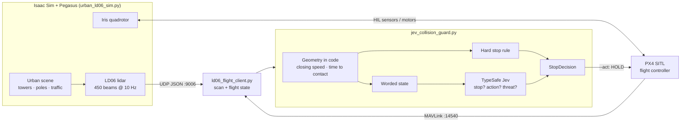

# JBCA — Jev-Based Collision Avoidance

JBCA is a simulated quadcopter that decides for itself when to stop before it hits something. An Iris drone carrying
a 360° **LDROBOT LD06** lidar flies through a procedural city with skyscrapers and moving traffic. TypeSafe's
System One model **Jev** reads a description of what the lidar sees and how the drone is moving, and decides
whether the drone has to stop. A hard safety rule in code backs Jev up.

Built on Isaac Sim 5.0, the Pegasus Simulator, PX4 SITL (v1.18), and TypeSafe Jev (`jev-latest`).



## Repository layout

| File | Purpose |
|---|---|
| `urban_ld06_sim.py` | Simulator app: builds the city, spawns the Iris with the LD06, and auto-launches PX4 |
| `urban_city.py` | Procedural city: street grid, towers, poles, and kinematic traffic loops |
| `ld06/ld06_lidar.py` | `LD06Lidar`, a Pegasus `Sensor` that simulates the spinning LD06 with PhysX raycasts |
| `ld06/ld06_backend.py` | `LD06OutputBackend`, which exports scans over UDP JSON, MAVLink `OBSTACLE_DISTANCE`, and ROS 2 |
| `ld06_flight_client.py` | `LD06FlightClient`, which reads the lidar scans and PX4 telemetry together in one Python process |
| `jev_collision_guard.py` | `CollisionGuard`, which turns scan and flight data into Jev questions and returns a `StopDecision` |
| `retrive_output.py` | Minimal example that prints scan and flight data as text |
| `ld06_udp_listener.py` | Standalone scan viewer, text or live polar plot |
| `.env.sample` | Template for the TypeSafe API key |

## Setup

**Requirements**
- Isaac Sim 5.0 at `~/isaacsim`
- Pegasus Simulator installed into Isaac Sim's Python
- PX4-Autopilot built for SITL at `~/PX4-Autopilot` (`make px4_sitl_default`)
- A Python ≥ 3.10 environment for the guard (here, the `jev` conda env)

**Guard environment and API key**
```bash
conda activate jev
pip install typesafe-sdk pymavlink numpy
cp .env.sample .env
```
Then put your TypeSafe key in `.env` (get one at https://console.typesafe.ai/keys). The guard reads
`TYPESAFE_API_KEY` from the environment first and falls back to `.env`. The variable name is case-insensitive. `.env` is git-ignored.

## Quick start

Use three terminals.

**Terminal 1: simulator and PX4**
```bash
~/isaacsim/python.sh ~/JBCA/urban_ld06_sim.py --visualize
```
Wait until PX4 is ready, then take off with QGroundControl, which connects on UDP 14550.

**Terminal 2: the Jev guard**
```bash
conda activate jev && cd ~/JBCA && python jev_collision_guard.py
```
Add `--act` to make it command PX4 HOLD when it decides to stop. Add `--dry-run --show-state` to see the JSON it
would send to Jev without making API calls.

**Terminal 3 (optional): watch the raw scans**
Don't run this at the same time as the guard, because both receive on UDP 9006.
```bash
python3 ~/JBCA/ld06_udp_listener.py --plot
```

Example guard output:
```
20:14:03 ok   [none] The drone is moving front and no obstacle is in its flight path. | jev p(stop)=0.03 action=continue(1.00) threat=back 847ms
20:14:07 STOP [jev] jev judged a collision risk (The drone is moving front toward a near obstacle (4.0 m) to the front; contact imminent (about 1.0 s).) | jev p(stop)=0.96 action=stop(1.00) threat=front 870ms
```

## How the collision decision works

`CollisionGuard.evaluate(scan, flight)` returns a `StopDecision`. It has `stop`, `source`, `reason`,
`stop_probability`, `action`, `action_confidence`, `threat_direction`, `latency_s`, and the `state` that was sent to Jev.

1. **Geometry in code.** The scan is reduced to 8 directions, each 45° wide. For each one the guard computes the
   nearest distance, the drone's closing speed from PX4 velocity and heading, the time to contact, and whether the
   direction lies within ±50° of the drone's direction of travel.
2. **Worded state for Jev.** The TypeSafe docs note that Jev is weaker with raw numbers than with semantic
   descriptions, and that it isn't a calculator. So each obstacle is described in words, for example
   `"proximity": "near"`, `"in_flight_path": "yes"`, `"drone_movement": "approaching this obstacle"`,
   `"contact": "imminent (about 1.0 s)"`. A one-line `summary` comes with it, and the most dangerous obstacle is listed first.
3. **Three typed questions in one call:**
   - `stop_needed` is a Noul: the probability that the drone must stop now.
   - `action` is a Choice between `continue`, `slow_down`, and `stop`.
   - `threat_direction` is a Choice between the 8 directions and `none`.
4. **Final decision in code:**

   | Source | Stops when |
   |---|---|
   | Hard rule, every 0.1 s | anything closer than **0.6 m** in any direction, an obstacle in the path closer than **1.5 m**, or time to contact under **1.0 s** |
   | Jev, every ~0.5 s | `p(stop) ≥ 0.6`, or `action == "stop"` with confidence `≥ 0.6` |
   | Stale data | no scan or telemetry in the last **1 s** |

   Jev runs in its own thread, so a slow or failed API call never delays the hard rule. The thresholds are constructor
   arguments of `CollisionGuard`, and `--threshold` sets the Jev threshold from the command line.

**Live Jev results on test scenarios**

| Scenario | Decision | Jev's answer |
|---|---|---|
| 4 m/s toward a wall 4 m ahead | STOP (Jev) | p=0.96, stop, threat=front |
| Hovering 2.5 m from a wall | ok | p=0.06, continue |
| Flying forward, wall only behind | ok | p=0.03, continue |
| 1 m/s, wall 7 m ahead | ok | p=0.07, slow_down |
| 1.2 m ahead while moving | STOP (rule + Jev) | p=0.97, stop |
| Rotated 90°, flying sideways into an obstacle | STOP (Jev) | p=0.96, threat=left |

## The simulation

**Scene (`urban_city.py`)**
- A 6×6 grid of blocks. Blocks are 40 m and streets are 14 m wide. The drone spawns at (0,0), the centre of an intersection.
- 15–180 m towers, tallest near the centre. Some have setback crowns and antennas.
- Traffic-light poles with mast arms at every corner, and street lights along the sidewalks.
- 24 cars, vans and buses on right-hand-traffic loops at 6–13 m/s. They are kinematic rigid bodies, so the lidar sees
  them and they push the drone.
- Every solid object has a PhysX collider. `--seed` rebuilds the same city.

**LD06 lidar (`ld06/ld06_lidar.py`)**

| | Real LD06 | Simulated |
|---|---|---|
| FOV | 360°, single plane | 360°, single plane |
| Scan rate | 5–13 Hz (10 nominal) | 10 Hz |
| Samples | 4500 /s | 4500 /s → 450 beams, 0.8° step |
| Range | 0.02–12 m | 0.02–12 m |
| Accuracy | ±10 mm (<0.3 m), ±45 mm beyond | σ = 10 mm / 15 mm Gaussian |

The head actually rotates: each physics step casts only the beams swept since the previous step, so scans taken
while the drone moves or yaws show real motion skew. The sensor is mounted 10 cm above the body centre and ignores
the drone's own colliders.

**Simulator flags:** `--headless`, `--no-px4`, `--mavlink-obstacles`, `--ros2`, `--visualize`, `--udp-port N`,
`--vehicles N`, `--blocks N`, `--seed N`, `--max-steps N`.

## Data interfaces

Angles are in the body frame with **0 = nose, counter-clockwise positive**. The MAVLink output is the exception: it uses PX4's clockwise convention.

| Interface | Where | Content |
|---|---|---|
| Lidar, UDP JSON | `127.0.0.1:9006` | `ranges[450]` (m, `null` = no return), `intensities`, `sectors_72` (min per 5°), `min_distance`, `stamp` |
| Lidar, MAVLink | PX4 UDP `14280` (`--mavlink-obstacles`) | `OBSTACLE_DISTANCE`, 72 × 5° bins in cm; feeds PX4 collision prevention (`CP_DIST`) |
| Lidar, ROS 2 | `/iris0/scan` (`--ros2`) | `sensor_msgs/LaserScan`; needs a working Isaac Sim ROS 2 bridge |
| Flight, MAVLink | PX4 UDP `14540` (API) / `14550` (QGC) | position, attitude, velocity, mode, armed state, battery |
| Both, Python | `LD06FlightClient().start().latest()` | `(scan, flight)` dicts |

Two port notes:
- Only one process can receive on a given UDP port. If you see `Address already in use`, find the holder with `ss -ulpn | grep 9006`.
- The MAVLink lidar output uses port 14280, not 14580. PX4 replies to the last sender on a port, so writing to 14580
  would take the telemetry stream away from tools on 14540.

To check that PX4 is receiving lidar data:
```bash
cd ~/PX4-Autopilot/build/px4_sitl_default && ./bin/px4-listener obstacle_distance
```

## Adding the LD06 to another Pegasus script

```python
from ld06 import LD06Lidar, LD06OutputBackend

config = MultirotorConfig()
config.sensors += [LD06Lidar({"position": [0, 0, 0.10]})]
config.backends = [PX4MavlinkBackend(px4_cfg),                  # must stay first: it drives the rotors
                   LD06OutputBackend(0, {"udp": True, "mavlink": True})]
```

## Known limitations

- **Latency:** each Jev call takes about 0.5–0.9 s, and at 4 m/s the drone covers 2–3.5 m in that time. The hard rule
  handles last-moment braking, so tune `hard_stop_distance` and `hard_stop_ttc` to your flight speed.
- **2D sensing only:** the LD06 scans one horizontal plane. Obstacles above or below it, such as the mast arms or the
  ground, are only seen when they cross that plane.
- **Traffic:** vehicles on crossing loops don't yield to each other and can overlap at intersections.
- **Speed:** headless, the simulator ran about 3.5× slower than real time on the development machine. PX4 stays in step with the sim, so flight is unaffected.
- **ROS 2:** the ROS 2 output is untested; the Isaac Sim ROS 2 bridge didn't start on the development machine.
- **Untested end to end:** the guard has been tested against live Jev on synthetic scenarios, but not yet in a
  closed loop with the running simulator.
